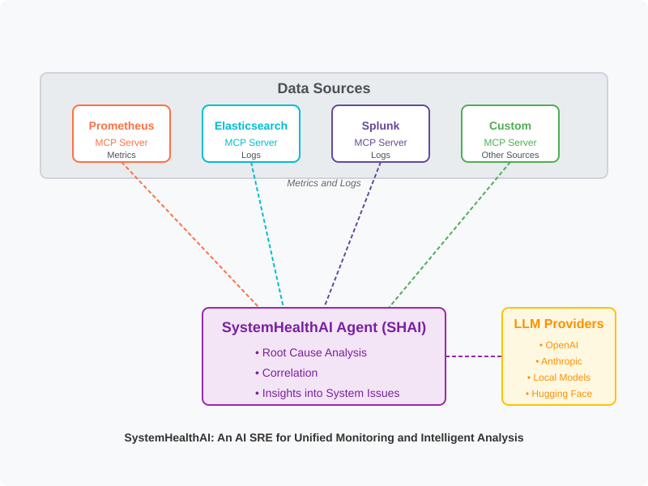

### AI SRE for system health triaging

As an SRE, Cloud engineer, you may have to constantly look at logs, metrics, traces to troubleshoot and triage issues to figure out why particular systems may be having issues. SystemHealthAI ( SHAI ) is an AI agent which will act as an AI SRE, to look at different data sources like prometheus, elasticsearch, cloudwatch, splunk and help triage issues and provide insights into why the system or systems might be acting up. 


### SHAI Architecture




### Show Your Support ⭐  
If you find SHAI useful, please consider giving it a **STAR** ! ⭐  


### Quick start 

### Pre-Reqs

- Install `uv` to run mcp servers
- OpenAI Api Key
- Datasource url for prometheus have a prometheus url ready to use
- pip or poetry  

#### Using pip 

```
pip install systemhealthai

```

#### From Source using poetry

```
git clone git@github.com:ajinkyakadam/systemhealthai.git
cd systemhealthai
poetry install -e . 
```

### Setup 

#### Update `example_mcp_server_config.json`

Ensure that the `example_mcp_server_config.json` file is updated with the correct configuration for your MCP servers. This assumes that the [Prometheus MCP server](https://github.com/pab1it0/prometheus-mcp-server) code is already downloaded and a Prometheus endpoint is available.

1. Locate the `example_mcp_server_config.json` file in your project directory.
2. Open the file in a text editor of your choice.
3. Update the `prometheus_endpoint` field with the URL of your Prometheus server. For example:
4. Save the file and ensure the MCP server is configured to use this updated configuration.

### Using SHAI

```
shai nodeA --model "openai:o4-mini"
```

The above command instructs shai to use the `o4-mini` model and triage the nodeA server. 
Please replace the nodeA with an actual hostname that you would like to find information for.


## Roadmap 

### Datasource support

| Data Source   | Status         | Description                                      |
|---------------|----------------|--------------------------------------------------|
| Prometheus    | ✅             | Find node metrics to correlate and triage health issues          |
| Grafana Loki  | 🟡             | search loki logs  |
| Elasticsearch | 🟡             | search elasticsearch logs for system issues        |
| Splunk        | 🟡             | search splunk logs for system issues |


### LLM Provider Support

| Provider       | Status         | Description                                      |
|----------------|----------------|--------------------------------------------------|
| OpenAI         | ✅             | Integrate with OpenAI models for advanced insights and triaging |
| Claude         | 🟡             | Support for Claude models to assist in system health analysis  |
| Hugging Face   | 🟡             | Utilize Hugging Face models         |
| Local LLMs     | 🟡             | Deploy and use local LLMs for on-premise triaging solutions     |


### How to Contribute 
Contributions are welcome, be it bug reports, feature requests, or PRs! 
- Open a github issue to report issues, or suggest features
- Open a pull request with improvements
- Share your experience and how it has been useful to you or your organization. 


### Citation 
If you use shai in your work, blogs, projects, please do cite:

```
@software{systemhealthai,
  author = {Kadam, Ajinkya},
  title = {SHAI: An AI SRE for triaging system health issues},
  year = {2025},
  publisher = {GitHub},
  url = {https://github.com/ajinkyakadam/systemhealthai}
}
```

### License 
MIT

